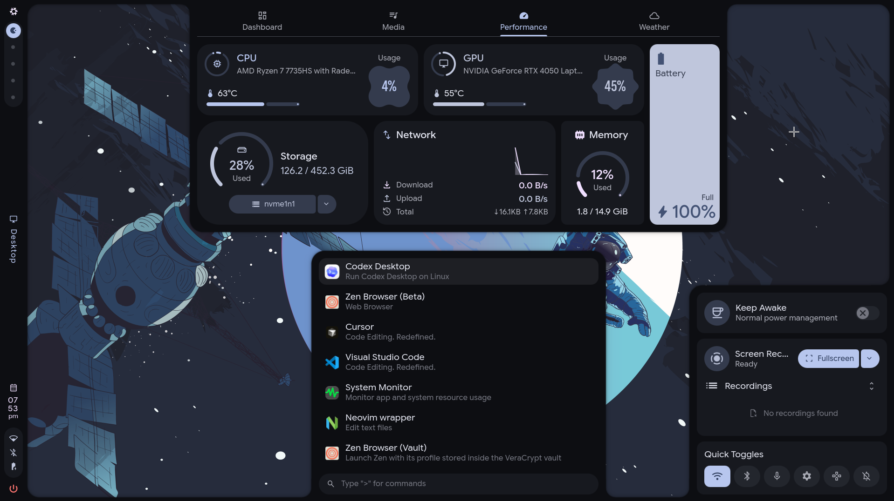
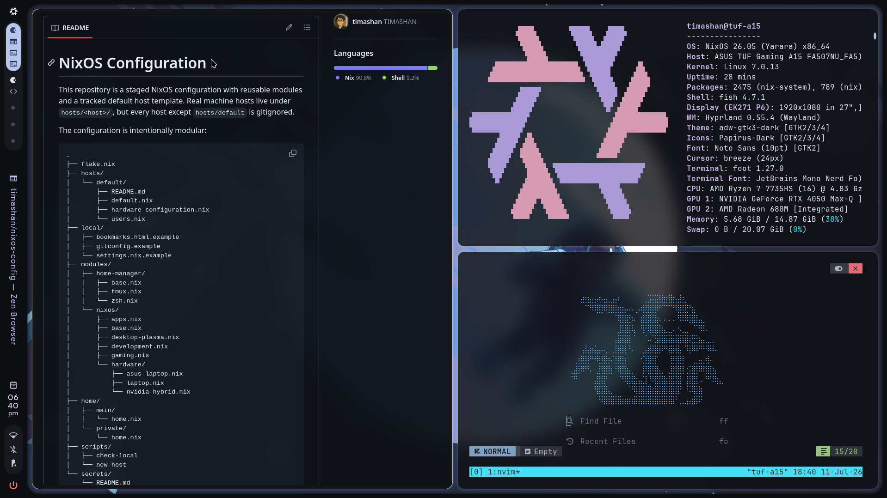
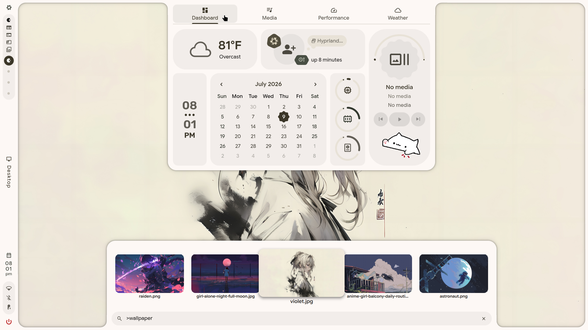

# NixOS Configuration

This repository is a staged NixOS configuration for an ASUS TUF Gaming A15
FA507NU.

Detected from Windows preflight:

- Model: ASUS TUF Gaming A15 FA507NU
- CPU: AMD Ryzen 7 7735HS, 8 cores / 16 threads
- GPU: AMD Radeon integrated graphics plus NVIDIA GeForce RTX 4050 Laptop GPU
- Wi-Fi: MediaTek Wi-Fi 6 MT7921
- Ethernet: Realtek RTL8168/8111 family
- Bluetooth: MediaTek USB Bluetooth adapter
- Audio: Realtek laptop audio plus AMD/NVIDIA HDMI audio
- Input: ASUS Precision Touchpad, ASUS System Control Interface v3
- Display: AUO B156HAN15.H internal panel, Acer EK271 P6 external display seen
- Storage: 512 GB Micron NVMe GPT disk with Windows, 1 TB Lexar NVMe MBR disk

## NixOS + Hyprland + Caelestia

| Home | Tiles | Themes |
| --- | --- | --- |
|  |  |  |

The configuration is intentionally modular:

```text
.
├── flake.nix
├── hosts/
│   ├── default/
│   │   ├── default.nix
│   │   ├── hardware-configuration.nix
│   │   └── users.nix
│   └── tuf-a15/
│       ├── default.nix
│       ├── hardware-configuration.nix
│       └── users.nix
├── local/
│   ├── bookmarks.html.example
│   ├── gitconfig.example
│   └── settings.nix.example
├── modules/
│   ├── home-manager/
│   │   ├── base.nix
│   │   ├── tmux.nix
│   │   └── zsh.nix
│   └── nixos/
│       ├── apps.nix
│       ├── base.nix
│       ├── desktop-plasma.nix
│       ├── development.nix
│       ├── gaming.nix
│       └── hardware/
│           ├── asus-laptop.nix
│           ├── laptop.nix
│           └── nvidia-hybrid.nix
├── home/
│   ├── main/
│   │   └── home.nix
│   └── private/
│       └── home.nix
├── scripts/
│   ├── check-local
│   ├── detect-local-hardware
│   └── new-host
└── secrets/
    └── README.md
```

## Important install note

Each real machine should have its own tracked host directory. For a new machine,
generate the hardware file after partitioning and mounting the target disk:

```bash
sudo nixos-generate-config --root /mnt
sudo cp /mnt/etc/nixos/hardware-configuration.nix ./hosts/<host>/hardware-configuration.nix
```

Do not run install commands against a disk until you have decided which SSD will
be erased or preserved.

The `tuf-a15` host has an install-only Disko layout in
`hosts/tuf-a15/disko.nix`. It keeps the reinstall layout simple:

```text
ESP   1G      vfat  /boot
root  rest    ext4  /
swap  17G     swap
```

This file is not imported by the normal host configuration, so
`nixos-rebuild switch --flake /etc/nixos#tuf-a15` does not repartition or format
the disk. Only run Disko intentionally from an installer or recovery
environment, after replacing the disk path if needed:

```bash
sudo nix run github:nix-community/disko -- --mode destroy,format,mount /etc/nixos/hosts/tuf-a15/disko.nix --argstr disk /dev/nvme0n1
```

## Quick local setup

For a new machine, the helper script creates a host folder from
`hosts/default`, sets the local host/user identity, and points
`/etc/nixos/local/settings.nix` at it:

```bash
sudo ./scripts/new-host <host> <user>
```

Then generate the real hardware config during install:

```bash
sudo nixos-generate-config --root /mnt
sudo cp /mnt/etc/nixos/hardware-configuration.nix /etc/nixos/hosts/<host>/hardware-configuration.nix
```

When the host is ready, track it in git:

```bash
git add hosts/<host>
```

Create the remaining local files/secrets the modules expect. Tracked examples
live in `local/*.example` and `secrets/README.md`.

```bash
cp /etc/nixos/local/gitconfig.example /etc/nixos/local/gitconfig
mkpasswd -m sha-512 | sudo tee /etc/nixos/secrets/<user>.password.hash >/dev/null
```

Edit `/etc/nixos/local/gitconfig` after copying it. Use either your normal
email address or GitHub's noreply format:
`your-github-username@users.noreply.github.com`.

Bookmarks are optional. If you want Zen to import bookmarks on first run, copy
`local/bookmarks.html.example` to `local/bookmarks.html` and edit it.

AWS files are optional. If this machine needs AWS CLI access, run
`aws configure`; Home Manager links `~/.aws/config` to
`/etc/nixos/local/aws/config` and `~/.aws/credentials` to
`/etc/nixos/secrets/aws/credentials`.

If you are setting up by hand instead of using `scripts/new-host`, start by
copying `local/settings.nix.example` to `local/settings.nix` and setting
`host`.

Check the local machine state before rebuilding:

```bash
./scripts/detect-local-hardware
nix flake update localConfig
./scripts/check-local
```

## Local settings

Machine-local identity is read from `/etc/nixos/local/settings.nix` through the
`localConfig` flake input:

```nix
{
  host = "tuf-a15";
  hostname = "tuf-a15";
  username = "timashan";
  diskDevices = {
    root = "/dev/disk/by-uuid/<root-uuid>";
    boot = "/dev/disk/by-uuid/<boot-uuid>";
    swap = "/dev/disk/by-uuid/<swap-uuid>";
  };
  gpuBusIds = {
    amdgpu = "PCI:<amd-bus>:0:0";
    nvidia = "PCI:<nvidia-bus>:0:0";
  };
}
```

The `local/` directory is gitignored, so this file is local to each machine.
Because it is an explicit path input, refresh the lock after editing it:

```bash
nix flake update localConfig
```

`host` selects the folder under `hosts/`. If it is omitted, it defaults to the
hostname. `username` is passed into the selected host's `users.nix`.
`diskDevices` and `gpuBusIds` are machine-specific values. Refresh them from the
running machine with:

```bash
./scripts/detect-local-hardware
```

Then refresh the `localConfig` lock entry before rebuilding:

```bash
nix flake update localConfig
./scripts/check-local
sudo nixos-rebuild switch --flake /etc/nixos#<host>
```

If `diskDevices` is omitted, the flake falls back to label-based devices
(`/dev/disk/by-label/nixos`, `/dev/disk/by-label/BOOT`, and
`/dev/disk/by-label/swap`). For normal installs, prefer the detected UUID paths
in local settings. For laptops, import `modules/nixos/hardware/laptop.nix` from
the host.

## Adding a new host

Create one host directory per machine:

```text
hosts/<host>/
├── default.nix
├── hardware-configuration.nix
└── users.nix
```

Copy an existing `default.nix` or start from `hosts/default/default.nix`, then
generate the hardware file during install:

```bash
sudo nixos-generate-config --root /mnt
cp /mnt/etc/nixos/hardware-configuration.nix ./hosts/<host>/hardware-configuration.nix
```

Select that machine in `/etc/nixos/local/settings.nix`:

```nix
{
  host = "<host>";
  hostname = "<hostname>";
  username = "<user>";
}
```

Use `modules/nixos/hardware/laptop.nix` for reusable laptop defaults, and keep
model-specific quirks in a separate hardware module.

## Forking home config

`home/main/home.nix` is the default daily-user Home Manager profile. If you fork
this repo and want to keep pulling upstream updates, avoid making heavy personal
edits directly in `home/main`.

Instead, create your own wrapper profile, for example:

```nix
# home/profiles/john.nix
{ ... }:

{
  imports = [
    ../main/home.nix
  ];

  # Personal overrides go here.
}
```

Then point your fork's flake or local settings at that profile. Keep
`home/main` close to upstream when you want future updates to merge cleanly.

## Private backup recovery

Private local files and secrets are backed up with Restic to the Google Drive
repository:

```text
rclone:gdrive:nixos-backups
```

Backups run daily at 23:30 with up to 30 minutes of random delay. Repository
pruning and the data check run separately on Sundays at 02:00, also with up to
30 minutes of delay. Both timers catch up after missed runs. Maintenance keeps
the same 14 daily, 8 weekly, and 12 monthly snapshots; it waits for repository
locks if a backup overlaps. Backup discovery prunes dependency/build folders
before scanning them. Both jobs run with reduced CPU and I/O priority.

The Restic repository password is stored locally at:

```text
/etc/nixos/secrets/restic/password
```

Keep a second copy of that password in Bitwarden or an offline recovery note.
The password file is included in the encrypted backup, but it cannot help with a
fresh restore because Restic needs the password before it can decrypt anything.

On a fresh machine, clone this repo, run the first rebuild to install
`restic`/`rclone`, recreate `/etc/nixos/secrets/restic/password` from the saved
copy, configure the `gdrive` rclone remote at
`/etc/nixos/secrets/restic/rclone.conf`, then restore:

```bash
sudo restic-nixos-backups snapshots
sudo restic-nixos-backups restore latest --target /
./scripts/detect-local-hardware
nix flake update localConfig
./scripts/check-local
sudo nixos-rebuild switch --flake /etc/nixos#<host>
```

## Updating AI tools

AI applications use the separately pinned `ai-nixpkgs` input so they can track
newer packages without upgrading the base NixOS system. Codex, Claude Desktop,
Hermes, and Herdr have their own inputs.

```bash
nix flake update ai-nixpkgs codex-cli-nix codex-desktop-linux claude-desktop
nix build .#nixosConfigurations.tuf-a15.config.system.build.toplevel
sudo nixos-rebuild switch --flake /etc/nixos#tuf-a15
```

Hermes and Herdr use release tags in `flake.nix`; change those tags when updating
them. Grok and Oh My Pi have local packages under `packages/`; update their
versions, npm lockfiles, and `npmDepsHash` together. The OpenClaw exception in
the `aiPkgs` import is version-specific and must be reviewed when it changes.

## ASUS laptop controls

The ASUS host uses the unofficial
[G-Helper Linux port](https://github.com/utajum/g-helper-linux), pinned to v1.0.93
through its upstream NixOS module. After rebuilding, launch **G-Helper** from
the application menu or run `ghelper`.

G-Helper replaces asusd, supergfxd, and power-profiles-daemon for performance,
fan, and GPU controls. The module installs hardware access rules and privileged
helpers; pending GPU mode changes are applied at boot. PRIME offload remains
the default, with automatic Eco mode at boot disabled. Home Manager disables
G-Helper autostart and startup update checks, removes its existing login launcher,
and makes manual launches open the window. Other preferences are preserved in
the writable config. In Hyprland, the Armoury Crate / ROG button launches
G-Helper on demand; while it is running, its own button handler toggles the
window. Quit G-Helper before rebuilding so the running app does
not overwrite these settings with its previously loaded values.

The NVIDIA module explicitly disables GSP and runtime D3 power switching to
match the documented resume stability workaround. These module parameters take
effect after reboot; disabling runtime D3 can increase undocked battery use.
The optional `asus-armoury` module is requested only on kernels at least 6.19;
the pinned 6.12 kernel continues to use its existing `asus-wmi` controls.

Nix store optimisation runs weekly on Saturday around noon, with up to one hour
of random delay and catch-up for missed runs. Vicinae still searches documents
and projects, but excludes browser profiles, caches, and other live application
state through `~/.config/vicinae/performance.json`. Its main settings remain
writable, and explicit settings there take precedence over this import.

Folder previews keep the four-tile layout. Images are reduced to at most
512×512 before retaining RGBA tiles; video/PDF extraction has a two-second
timeout and shares a six-second extraction budget per folder. The package's
install checks exercise size bounds, alpha preservation, file selection,
converter timeouts, and the folder budget. Helium profile setup runs on launch
instead of during login, and repeated seeding avoids rewriting unchanged files.

## Obsidian sync

Obsidian is installed by the system configuration. The vault path is:

```text
/home/timashan/Documents/Vaults
```

That directory is included in the encrypted Restic backup.

For phone/laptop sync, use Syncthing with the Obsidian vault folder:

1. Rebuild the system to enable the Syncthing service.
2. Open Syncthing on the laptop at <http://127.0.0.1:8384>.
3. Install Syncthing-Fork on Android.
4. Pair the phone and laptop.
5. Share `/home/timashan/Documents/Vaults` from the laptop to the phone.
6. Open the synced phone folder as an Obsidian vault.

Syncthing handles live file sync. Restic handles encrypted, versioned backup to
Google Drive.
